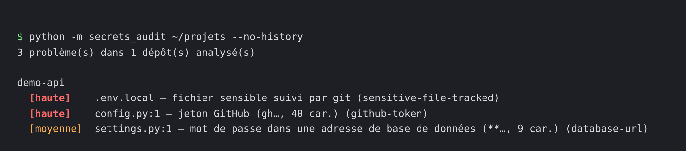

# secrets-audit

Audit d'hygiène des secrets dans les dépôts git d'un dossier. Script Python sans dépendance externe : il repère ce qui ne devrait pas être versionné et ce qui ressemble à un secret, sans jamais afficher la valeur en entier.

## Ce qu'il vérifie

| Règle | Gravité | Ce qu'elle signale |
|---|---|---|
| `sensitive-file-tracked` | haute | fichier sensible suivi par git (`.env.local`, `.env.nas`, `*.key`, `*.kdbx`, `id_rsa`...) |
| `sensitive-file-unignored` | moyenne | fichier sensible présent mais absent du `.gitignore` |
| `sensitive-file-in-history` | haute | fichier sensible supprimé mais toujours dans l'historique |
| `private-key`, `github-token`, `aws-access-key`, `slack-token` | haute | secret reconnu dans un fichier suivi |
| `gitlab-token`, `stripe-key`, `google-api-key`, `anthropic-key`, `openai-key`, `npm-token`, `telegram-bot-token` | haute | clé d'un service reconnue à son préfixe (les clés Stripe de test ne sont pas signalées) |
| `database-url` | moyenne | mot de passe écrit dans une adresse `postgresql://`, `mysql://`, `mongodb://`, `redis://`... |
| `jwt`, `generic-assignment` | moyenne | jeton JWT, ou `password`, `secret`, `token`, `api_key` affecté à une valeur qui ressemble à un vrai secret |

Les valeurs d'exemple (`changeme`, `${VAR}`), les expressions de code, les noms d'identifiants et les réglages (`PASSWORD_ALGORITHM`) sont ignorés. Dans les chemins de test, de fixture, de simulation et de documentation, les trouvailles ambiguës passent en gravité faible ; un jeton ou une clé privée reste de gravité haute partout.



## Lancer

```bash
python -m secrets_audit D:\Projet_dev          # tous les dépôts jusqu'à 2 niveaux
python -m secrets_audit . --json               # rapport JSON
python -m secrets_audit . --sarif > audit.sarif # rapport SARIF 2.1.0
python -m secrets_audit . --ignore 'docs/*'    # ignorer des chemins (répétable)
python -m secrets_audit . --min-severity high  # n'échouer que pour les gravités hautes
python -m secrets_audit . --no-history         # plus rapide, sans l'historique
```

Code de sortie : 0 propre, 1 problèmes à la gravité demandée ou au-dessus (moyenne par défaut), 2 erreur (dossier introuvable, git absent).

## Avant chaque commit

```bash
python -m secrets_audit . --install-hook       # pose .git/hooks/pre-commit
python -m secrets_audit . --staged             # ce que le hook lance, à la main
```

Le hook analyse ce qui est dans l'index, pas le disque : un secret ajouté puis effacé du fichier sans refaire `git add` bloque quand même le commit. Il refuse d'écraser un hook pre-commit qui n'est pas le sien. Pour passer outre une fois, `git commit --no-verify`.

Avec [pre-commit](https://pre-commit.com), le dépôt fournit aussi un `.pre-commit-hooks.yaml` :

```yaml
repos:
  - repo: https://github.com/Remiverhaeghe/secrets-audit
    rev: main
    hooks:
      - id: secrets-audit
```

Pour marquer une ligne comme volontaire, ajouter `secrets-audit: ignore` en commentaire sur la même ligne.

## Dans la CI d'un autre dépôt

Le dépôt fournit un workflow réutilisable. Dans le dépôt à surveiller, `.github/workflows/secrets.yml` :

```yaml
name: Secrets
on: [push, pull_request]
permissions:
  contents: read
jobs:
  audit:
    uses: Remiverhaeghe/secrets-audit/.github/workflows/audit.yml@main
    with:
      min-severity: medium      # facultatif
      ignore: "docs/* tests/*"  # facultatif, motifs séparés par des espaces
```

`version` choisit la branche ou le tag de l'outil (`main` par défaut). Avec `sarif: true`, les trouvailles s'affichent aussi dans l'onglet Security du dépôt, sur la ligne concernée ; le workflow appelant doit alors accorder `security-events: write` :

```yaml
jobs:
  audit:
    permissions:
      contents: read
      security-events: write
    uses: Remiverhaeghe/secrets-audit/.github/workflows/audit.yml@main
    with:
      sarif: true
```

 La CI de ce dépôt appelle le même workflow sur lui-même.

## Tests et qualité

```bash
python3 -m unittest discover -s tests -v
python3 -m venv .venv && .venv/bin/pip install -r requirements-dev.txt
.venv/bin/black --check . && .venv/bin/pylint secrets_audit && .venv/bin/bandit -r secrets_audit
.venv/bin/coverage run -m unittest discover -s tests && .venv/bin/coverage report
```

La CI exécute la même chose, puis audite le dépôt lui-même.

## Limites

- Il analyse les fichiers suivis par git, pas le contenu des anciens commits : l'historique n'est contrôlé que par les noms de fichiers sensibles.
- La détection de mots de passe est heuristique : elle peut manquer un secret court ou signaler un exemple. Un outil dédié (Gitleaks) reste utile en complément.

## Licence

MIT, voir `LICENSE`.
